# IT News Factory 🎬🤖

> **Autonomous end-to-end pipeline:** Drops in Telegram $\rightarrow$ Automated Scrape $\rightarrow$ Local LLM Scripting $\rightarrow$ Kokoro TTS $\rightarrow$ Concat Video Assembly $\rightarrow$ Zero-Touch YouTube Shorts Publishing.

---

## 📌 Overview

**IT News Factory** is an autonomous content generation and publishing engine running on Debian Linux (optimized for Ryzen AI 9 HX 370 and RTX 3060). When you drop tech news links, screenshots, or screen recordings into a private Telegram chat, the system automatically builds an ironic, high-retention vertical short (1080x1920) and publishes it directly to YouTube Shorts with zero manual intervention.

### Core Architectural Breakthrough: Bypassing Concat Issue #707
Concat v0.2.9 exposes its timeline manipulation, whisper captions, and video rendering APIs over a local window JSON-RPC socket, but its internal TTS engine (`concat-speech`) is currently GUI-only ([Issue #707](https://github.com/concat-app/concat/issues/707)). 

**The Solution:** We synthesize voiceover locally using Python and `kokoro-onnx` (the exact same voice model Concat uses under the hood), probe the exact audio duration $T$, and inject `narration.wav` via Concat's window JSON-RPC `media_import` API.

---

## 🏗️ System Architecture

```mermaid
flowchart TD
    User["📱 User (Telegram Drop: Link + Media)"] --> Bot["🤖 Telegram Bot (aiogram)<br/>15s SQLite Debounce across media_group_id"]
    
    subgraph Stage1 ["Stage 1: Ingestion & Scraping"]
        Bot --> Scraper["🌐 Scraper & Context Builder<br/>trafilatura + Playwright Fallback"]
        Scraper --> RawContext["Extracted Article Text + OG / Captured Images"]
    end

    subgraph Stage2 ["Stage 2: Scriptwriting"]
        RawContext --> LLM["🧠 Local LLM (Ollama / llama.cpp)<br/>Structured JSON: Hook, Body, Punchline"]
    end

    subgraph Stage3 ["Stage 3: Audio Generation"]
        LLM --> TTS["🎙️ Local TTS (kokoro-onnx)<br/>Generates narration.wav (Duration T)"]
    end

    subgraph Stage4 ["Stage 4: Concat Window Automation"]
        TTS --> ConcatIPC["🔌 Concat Window JSON-RPC Client<br/>Reads ~/.config/concat/automation.json"]
        ConcatIPC --> ConcatApp["🖥️ Concat Desktop (Window Mode)"]
        ConcatApp --> C1["project_create (1080x1920, 30fps)"]
        C1 --> C2["media_import (narration.wav + media)"]
        C2 --> C3["clip_add (narration on audio lane)"]
        C3 --> C4["Visual Track Loop (8.0s Ken Burns Keyframes)"]
        C4 --> C5["captions_add (in-process whisper.cpp)"]
        C5 --> C6["export_start -> final_short.mp4"]
    end

    subgraph Stage5 ["Stage 5: Publishing"]
        C6 --> YT["📺 YouTube Data API v3<br/>Resumable Upload (Public + #Shorts)"]
    end

    subgraph Stage6 ["Stage 6: Confirmation"]
        YT --> Notify["💬 Telegram Notification<br/>Live YouTube Shorts URL replied to thread"]
    end
```



---

## ⚡ Key Technical Highlights

### 1. Window-Attached Concat Automation
- **Zero Interference:** Runs via Concat's `window` mode, isolating agent automation from any manual projects open on screen.
- **Dynamic Port Discovery:** On Linux, Concat writes its active port and authorization token to `~/.config/concat/automation.json`. The pipeline reads this file on every run, remaining immune to port shifts across application restarts.
- **Exposed APIs Utilized:** `project_create`, `project_set_video`, `media_import`, `clip_add`, `keyframe_set`, `captions_add`, `project_save`, `export_start`, `export_wait`.

### 2. High-Retention LLM Scripting
- **Length Constraint:** Strictly 85–115 words (~35–45 seconds at 1.05x–1.10x speech rate), perfectly tuned for YouTube Shorts retention algorithms.
- **Pacing Structure:**
  - `0–3s (The Hook):` Cynical/ironic industry call-out.
  - `3–30s (The Meat):` Concrete engineering facts, architectural details, metrics, or bugs.
  - `30–40s (The Punchline):` Sarcastic takeaway or pragmatic engineering punchline.
- **Format Guarantee:** Ollama `format="json"` schema enforces spoken plain text without emojis or markdown, spelling out numbers and abbreviations for phonetic speech synthesis.

### 3. Dynamic Visual Looping & Ken Burns Math
- Audio duration $T$ acts as the absolute timeline anchor.
- User video clips (screen recordings) are inserted first (ducked/muted).
- The remaining duration $(T - T_{\text{videos}})$ is sliced into alternating 8.0-second Ken Burns zoom loops (`1.0` $\rightarrow$ `1.10` and `1.10` $\rightarrow$ `1.0`).
- The terminal clip is trimmed to the exact remaining fraction of a second so visuals end in lockstep with the narrator's last word.
- Headless Playwright / OpenGraph scraper guarantees visual assets even if the user drops only a bare URL.

### 4. Zero-Touch YouTube Publishing
- Official `google-api-python-client` with resumable upload chunking.
- Persistent OAuth tokens via `token.json` (`youtube.upload` scope).
- Automated metadata tagging: `privacyStatus: "public"`, `categoryId: "28"` (Science & Technology), and appended `#Shorts #TechNews`.

---

## 📂 Project Structure

```text
it-news-factory/
├── config.example.yaml      # Configuration template (Telegram, Ollama, Kokoro, Concat, YouTube)
├── config.py                # Type-safe configuration loader with environment variable overrides
├── database.py              # SQLite queue manager and 15s debounce state machine
├── bot.py                   # Telegram listener + SQLite 15s media-group debouncer
├── scraper.py               # Article text (trafilatura) & fallback image grabber (Playwright)
├── writer.py                # Ollama structured JSON script generator
├── tts.py                   # kokoro-onnx WAV synthesis & exact duration probe
├── concat_client.py         # JSON-RPC client reading ~/.config/concat/automation.json
├── timeline.py              # Ken Burns visual timeline planner and subtitle coordinator
├── youtube_uploader.py      # Resumable YouTube Data API v3 uploader
├── pipeline.py              # End-to-end coordinator and Telegram reporter
├── AGENTS.md                # Operating guidelines and verified commands for AI agents
├── context/                 # Detailed architectural and subsystem specifications
│   ├── index.md             # Documentation navigation map
│   ├── architecture.md      # Full lifecycle, data flow, IPC protocols
│   ├── modules.md           # Module-by-module interfaces and responsibilities
│   ├── dependencies.md      # Dependency catalog, system requirements, APIs
│   └── conventions.md       # Engineering conventions, error handling, Ken Burns math
└── docker-compose.yml       # Containerized service configuration
```

---

## 🚀 Getting Started

### Prerequisites
- **OS:** Debian Linux / Ubuntu (or any Linux with systemd / X11 / Wayland).
- **Hardware:** Ryzen AI 9 / RTX 3060 (or compatible CUDA / ROCm / Vulkan GPU).
- **Software:**
  - Python 3.11+
  - Concat Desktop ($\ge$ v0.2.9) with **Settings > Automation > Scripts and apps** enabled.
  - [Ollama](https://ollama.com/) running locally (configured for `http://192.168.1.124:11434` with `qwen2.5-coder:14b`).
  - Google Cloud Project with YouTube Data API v3 enabled and OAuth credentials.

### Installation

```bash
# 1. Clone repository
git clone https://github.com/your-username/it-news-factory.git
cd it-news-factory

# 2. Create and activate virtual environment
python3 -m venv .venv
source .venv/bin/activate

# 3. Install dependencies
pip install -r requirements.txt
playwright install chromium
```

### Configuration (`config.yaml` or `config.example.yaml`)

```yaml
telegram:
  bot_token: "YOUR_TELEGRAM_BOT_TOKEN"
  allowed_chat_ids:
    - 123456789
  debounce_seconds: 15
  database_path: "queue.db"

scraper:
  user_agent: "Mozilla/5.0 (X11; Linux x86_64) AppleWebKit/537.36 (KHTML, like Gecko) Chrome/128.0.0.0 Safari/537.36"
  screenshot_timeout_ms: 15000

ollama:
  host: "http://192.168.1.124:11434"
  model: "qwen2.5-coder:14b"
  temperature: 0.7

tts:
  model_path: "models/kokoro-v0_19.onnx"
  voices_path: "models/voices.bin"
  voice: "am_adam"
  speed: 1.08

concat:
  config_path: "~/.config/concat/automation.json"
  resolution: [1080, 1920]
  fps: 30
  background: "blur"
  export_timeout_seconds: 180

youtube:
  client_secrets_file: "credentials/client_secret.json"
  token_file: "credentials/token.json"
  privacy_status: "public"
  category_id: "28"
  default_tags:
    - "Shorts"
    - "TechNews"
    - "Programming"
    - "AI"
```

### Running the Service

```bash
# Run the pipeline bot
python bot.py
```

---

## 📚 Documentation
For complete architectural details, module specs, and agent instructions, refer to:
- [AGENTS.md](./AGENTS.md) — Operational guidelines for AI agents working in this repo.
- [context/architecture.md](./context/architecture.md) — Deep dive into the 6-stage pipeline.
- [context/conventions.md](./context/conventions.md) — Ken Burns math, audio anchoring, and error handling.
