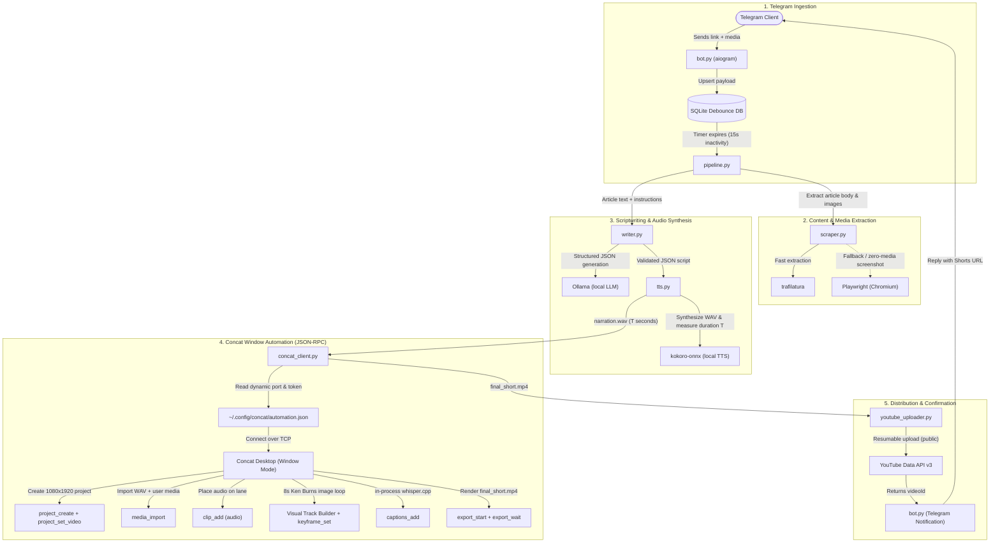

# System Architecture

## High-Level Overview

**IT News Factory** converts informal links and media items dropped into a private Telegram channel into fully edited, captioned, and published YouTube Shorts. The system runs locally on a Debian Linux host equipped with an AMD Ryzen AI 9 HX 370 processor and an NVIDIA RTX 3060 GPU.



---

## The Concat Architecture & Issue #707 Workaround

### Concat Automation Model
Concat Desktop (v0.2.9+) provides an automation API via a window JSON-RPC socket:
- Enabled in Concat via **Settings > Automation > Scripts and apps**.
- On Linux, Concat writes connection parameters to `~/.config/concat/automation.json` upon startup:
  ```json
  {
    "port": 49152,
    "token": "bearer-token-random-hex"
  }
  ```
- Connecting to this port exposes the `window` automation interface. In `window` mode, jobs run in isolated projects without overwriting whatever manual project the user currently has open on screen.

### Issue #707: TTS Engine Isolation
In Concat v0.2.9, while `captions_add` (in-process `whisper.cpp`), `media_import`, `clip_add`, `keyframe_set`, and `export_start` are fully exposed over the JSON-RPC interface, Concat's TTS engine (`concat-speech`) remains GUI-only and is not callable over the automation socket ([Issue #707](https://github.com/concat-app/concat/issues/707)).

**Engine Equivalence Solution**:
Concat utilizes the **Kokoro** TTS engine under the hood. By running `kokoro-onnx` locally in Python:
1. We obtain identical voice quality and characteristics to Concat's native speech.
2. We can synthesize `narration.wav` ahead of video timeline construction.
3. We measure the exact audio duration $T$ with millisecond precision (`soundfile` / `wave`).
4. We feed `narration.wav` into Concat via `media_import` and `clip_add`.
5. Concat's native `captions_add` processes `narration.wav` using its built-in `whisper.cpp`, generating flawless word-synced animated captions.

---

## 6-Stage Execution Lifecycle

### Stage 1: Telegram Ingestion & SQLite Debouncing
When a user sends an article link with accompanying media in Telegram, Telegram distributes multiple files across individual messages that share a single `media_group_id`:
- `bot.py` listens for incoming text, photos, and videos.
- Messages are upserted into an SQLite database (`queue.db`).
- A 15-second debounce window restarts upon every incoming message for the active group or user.
- When 15 seconds elapse with no further activity, the debounce worker locks the batch and hands it off to `pipeline.py`.

### Stage 2: Scraper & Context Builder
`scraper.py` ingests the submitted URL:
1. **Primary Extraction:** Uses `trafilatura` to extract clean article text, metadata, and OpenGraph (OG) image URLs.
2. **Fallback / Media Enrichment:** If the user provided no media and the page contains insufficient high-resolution images, `scraper.py` spawns a headless Playwright Chromium instance to take full-height or section screenshots of the target site.

### Stage 3: Local LLM Scriptwriting
`writer.py` prompts a local LLM hosted on Ollama (default endpoint `http://192.168.1.124:11434` running `qwen2.5-coder:14b`):
- **Structured Schema:** Enforces Ollama's `format="json"`:
  ```json
  {
    "hook": "Spoken hook text (0-3s)",
    "script": "Complete spoken voiceover narration (85-115 words)",
    "yt_title": "YouTube title (< 60 chars) with #Shorts",
    "yt_desc": "SEO description with #Shorts #TechNews and article source"
  }
  ```
- **Voiceover Guidelines:**
  - `0–3s (The Hook):` Cynical, high-impact one-liner.
  - `3–30s (The Meat):` Technical facts, architecture, numbers, or failure modes.
  - `30–40s (The Punchline):` Sarcastic engineering takeaway.
  - **Phonetic Speech Rules:** No markdown, no emojis, numbers and units spelled out (e.g. "three point five gigahertz", "ten million dollars").

### Stage 4: Local TTS Synthesis
`tts.py` runs `kokoro-onnx` on RTX 3060 / Ryzen AI 9:
- Reads the validated spoken script.
- Generates `narration.wav` (24kHz, 16-bit mono).
- Calculates exact duration $T$ in seconds (e.g., $T = 38.4\text{s}$).

### Stage 5: Concat Window Automation
`concat_client.py` connects to Concat Desktop:
1. `project_create`: Initializes a blank project.
2. `project_set_video`: Configures canvas to `1080x1920` (9:16 vertical), 30fps, with blurred background fill (`timeline_background: "blur"`).
3. `media_import`: Imports `narration.wav`, user-submitted videos, and images.
4. `clip_add`: Places `narration.wav` on the master audio lane.
5. **Visual Track Loop Builder:**
   - Any user-supplied screen recordings/videos are laid out first (audio ducked or muted).
   - Remaining timeline duration $T_{\text{rem}} = T - T_{\text{videos}}$ is covered using 8.0-second image slots looping the available image pool.
   - For each image clip, calls `keyframe_set` to apply alternating Ken Burns zooms:
     - Slot 1: scale `1.0` $\rightarrow$ `1.10`
     - Slot 2: scale `1.0` $\rightarrow$ `1.10`
     - Slot 3: scale `1.10` $\rightarrow$ `1.0` (alternating direction prevents fatigue)
   - The final image slot is trimmed to the exact remaining time so visual playback cuts precisely at $T$.
6. `captions_add`: Triggers in-process `whisper.cpp` to transcribe `narration.wav` and stamp animated word-level captions.
7. `project_save` + `export_start`: Triggers rendering to `final_short.mp4`.
8. `export_wait`: Polls or waits on render completion.

### Stage 6: YouTube Publishing & Telegram Confirmation
`youtube_uploader.py` uploads the rendered video:
- Uses `google-api-python-client` with resumable file upload.
- Reads cached OAuth tokens from `token.json` (`youtube.upload` scope).
- Sets `privacyStatus: "public"`, `categoryId: "28"` (Science & Technology), and ensures `#Shorts` is in the title.
- Returns the live URL (`https://youtube.com/shorts/<video_id>`).
- `bot.py` sends a Telegram reply to the original drop with the published link.
