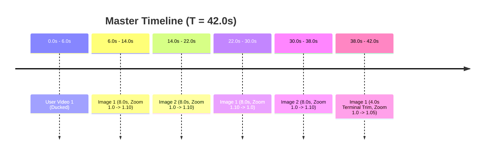

# Engineering Conventions & Mathematical Models

This document defines algorithmic formulas, coding standards, timing invariants, and error-handling patterns implemented across **IT News Factory**.

---

## 1. Timing Invariants & Master Clock Audio Anchoring

In video generation pipelines, audio drifting causes desynchronization and poor user retention. In IT News Factory:

> [!IMPORTANT]
> The synthesized narration audio duration $T$ is the **absolute master clock**. The visual timeline, Ken Burns transitions, and export bounds must conform strictly to $T$.



---

## 2. Ken Burns Visual Looping & Math Specification

### Parameters
- $T$: Total narration audio duration in seconds (e.g. $42.0\text{s}$).
- $T_{\text{videos}}$: Sum of durations of all user-dropped video clips.
- $T_{\text{rem}} = T - T_{\text{videos}}$: Time that must be populated with images.
- $\mathcal{I} = [img_0, img_1, \dots, img_{M-1}]$: Array of $M$ available images (from Telegram and/or scraper).
- $S = 8.0\text{s}$: Standard duration per image slot.

### Algorithm
1. Calculate required number of slots:
   $$N = \left\lceil \frac{T_{\text{rem}}}{S} \right\rceil$$
2. For each slot index $i \in \{0, 1, \dots, N-1\}$:
   - **Start timestamp**: $t_{\text{start}} = T_{\text{videos}} + (i \times S)$
   - **Slot duration**:
     $$d_i = \begin{cases} 
     S & \text{if } i < N - 1 \\ 
     T_{\text{rem}} - (i \times S) & \text{if } i = N - 1 
     \end{cases}$$
   - **Image selection**: $img = \mathcal{I}[i \pmod M]$
   - **Keyframe Ken Burns Zoom**:
     - Even slots ($i \pmod 2 = 0$): Scale $1.0 \rightarrow 1.10$ over normalized interval $[0.0, 1.0]$.
     - Odd slots ($i \pmod 2 = 1$): Scale $1.10 \rightarrow 1.0$ over normalized interval $[0.0, 1.0]$.
     - Terminal trimmed slot ($i = N - 1$): Pro-rate ending scale:
       $$\text{scale}_{\text{end}} = 1.0 + \left(0.10 \times \frac{d_i}{S}\right)$$

---

## 3. Scriptwriting & TTS Rules

### Word Budget & Speech Rate
- **Target Video Length**: 35–45 seconds.
- **Kokoro Speech Rate**: 1.05x–1.10x speed (~2.5–2.8 words per second).
- **Target Word Count**: Strictly **85–115 words**.

### Phonetic Sanitization Rules
The LLM generated text must be phonetically compliant before passing to `tts.py`:
1. **No Markdown Symbols**: Strip asterisks (`*`), backticks (`` ` ``), hashes (`#`), underscores (`_`), and angle brackets (`< >`).
2. **No Emojis**: Regex strip all Unicode emoji ranges.
3. **Number & Symbol Expansion**:
   - `$42M` $\rightarrow$ "forty-two million dollars"
   - `3.5` $\rightarrow$ "three point five"
   - `1st` $\rightarrow$ "first"
   - `100k` $\rightarrow$ "one hundred thousand"
   - `AI` $\rightarrow$ "A I"
   - `API` $\rightarrow$ "A P I"

---

## 4. SQLite Debounce & Concurrency Protocol

Telegram sends grouped media as individual HTTP updates sharing a `media_group_id`. To aggregate them cleanly:

1. **Upsert & Timer Reset**:
   - Each message update queries `queue.db` for an active pending batch matching `chat_id` and `media_group_id` (or within the 15s window).
   - Updates `last_updated_at = CURRENT_TIMESTAMP`.
   - Saves file metadata to `batch_media`.
2. **Debounce Expiration**:
   - Worker queries:
     ```sql
     SELECT id FROM batches 
     WHERE status = 'pending' 
       AND (strftime('%s', 'now') - strftime('%s', last_updated_at)) >= 15;
     ```
3. **Atomic Lock**:
   - Worker transitions batch:
     ```sql
     UPDATE batches SET status = 'processing' WHERE id = ? AND status = 'pending';
     ```
   - Only if 1 row is affected does the pipeline begin execution.

---

## 5. Error Handling & Recovery

| Failure Mode | Detection | Mitigation & Fallback |
| :--- | :--- | :--- |
| Empty media drop | User dropped URL only | Scraper extracts OG images; fallback to Playwright headless screenshot. |
| Concat connection failure | `automation.json` missing or refused | Verify Concat is running in GUI with Automation enabled; log retry warning. |
| Export timeout | `export_wait` exceeds 180s | Abort export job, restart Concat client connection, retry once. |
| LLM JSON parsing error | `json.loads` fails on Ollama reply | Retry generation with temperature=0.2 and explicit JSON system prompt. |
| YouTube API rate limit | Quota exceeded (403) | Persist rendered video locally; alert user via Telegram with manual download link. |
